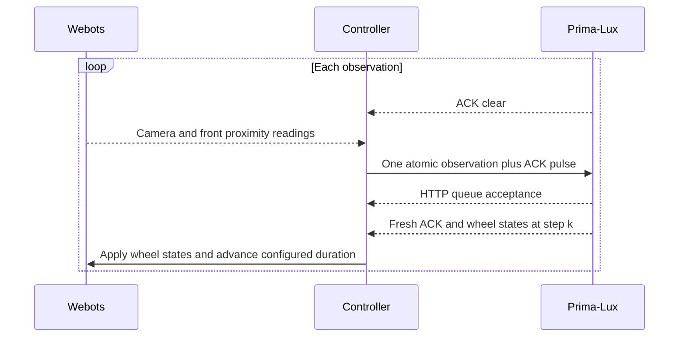

# One observation, one ACK, one movement step

The body stays synchronized with the brain. The controller sends an observation,
waits for its neural ACK, applies the wheel states from that ACK frame, and advances
Webots by the configured `physics_step_ms` duration (32 ms by default). There is no extra neural readout window.

Webots does not advance while the controller waits. The initial sensor-enabling
step runs with both motors at zero, before starting the neural session.

`physics_step_ms` accepts positive integer multiples of the world's 16 ms basic
physics interval, such as 16, 32 and 64. Increasing it extends the duration of
each acknowledged wheel command. The brain/body exchange stays synchronous;
there is still one observation and one movement interval per ACK. The next
sensor observation occurs after that entire movement interval.

## The isolated circuit

TRANSPORT_ACK is a one-value marker input sent in the same sensor frame as
CAMERA, PROX_LEFT and PROX_RIGHT. It excites TRANSPORT_ACK_RELAY, a high-gamma
T10 OPU, which excites TRANSPORT_ACK_OUT.

The ACK output excites TRANSPORT_ACK_CLEAR, another high-gamma T10 OPU. This
clearing OPU inhibits the ACK output and itself. The self-inhibitory connection
is marked as feedback. No ACK population connects to a turn or wheel pathway.

ACK confirms the marker's neural processing. Wheel outputs remain the actual
neural motor state at that step; ACK does not itself select a movement or prove
that the sensory pathways have settled.

## The controller sequence

1. Wait until the ACK output is clear. Drain already-received frames so an old
   zero cannot hide a newer high ACK. There is no fixed quiet-frame count.
2. Capture the current camera and proximity measurements, then submit them with
   the ACK marker in one `session.publish_sensor_frame(...)` call.
3. Require the SDK's atomic queue acceptance and a positive neural ACK at a step
   newer than the submission cursor. An HTTP receipt or wheel activity alone
   cannot acknowledge the observation. ACK received during the HTTP request
   remains buffered and is used when that request returns.
4. Immediately decode that ACK frame's two wheel outputs and advance the body
   by `physics_step_ms`. No subsequent neural frames are awaited first.
5. Repeat after the ACK output clears. One observation is outstanding at a time.

Missing output frames, a stuck ACK or a timeout end the run without blindly
resending an observation. The output stream timeout is 5 seconds by default;
ACK clear and ACK arrival each have a 30-second deadline. Stop requests interrupt
the wait, zero the motors and begin the SDK's Stop/save process.

Closing Webots also triggers the launcher's independent device Stop/save check,
even if its controller exits before cleanup finishes.

## Observe and modify

The console's `ACK=<step>` and `decision=<step>` must match. Sensor logs record
submission and ACK timestamps. Run logs record the exact output frame applied,
the observation and simulation time. `sim/wall` reports simulation time divided
by elapsed wall time; synchronous execution speed depends on actual ACK latency.

Keep the ACK circuit connected when modifying Primitive A. Changes to its
operating points or feedback require checking on the device that the pulse
rises and clears for each observation. Local protocol tests cannot establish
the compiled circuit's neural timing.
